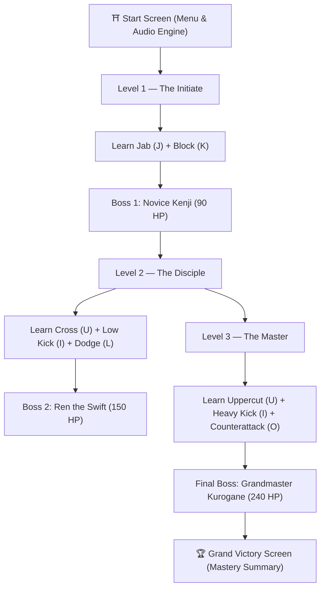

# 🥋 Shadow Dojo — Learn. Fight. Master.

> **2D Martial Arts Silhouette Fighting Game & Interactive Learning Experience**  
> Developed for the 18-hour IIT Roorkee Hackathon.

Inspired by the visual and combat elegance of *Shadow Fight*, **Shadow Dojo** is a single-player martial arts game where players do not merely fight—they **learn** fighting moves through active, feedback-driven practice.

---

## 🌟 Core Innovation: The Learning System

In traditional fighting games, players are overwhelmed with a dense move list and expected to memorize button combinations before ever stepping into the arena.

In **Shadow Dojo**, move mastery is integrated directly into the combat progression across **3 ranks**:
1. **Introduction**: The move is presented with its name, keyboard control, and tactical purpose.
2. **Demonstration & Context**: The player sees the timing, range, and execution window.
3. **Interactive Trial**: The player executes the technique against a reactive sparring dummy.
4. **Real-time Pedagogical Feedback**: The game verifies execution accuracy. If an attack is thrown out of range, the system alerts the player (`"Too far away! Move closer with A/D"`). Progress only increments on valid hits, blocks, or evasions.
5. **Practice Challenge**: The player must prove consistency (e.g. landing 3 valid strikes, holding guard through 3 strikes, or cleanly dodging through 3 sweeps).
6. **Mastery Unlock**: The technique is permanently unlocked in the player's arsenal, culminating in a test against the rank's challenger.

---

## 🎮 Game Flow & 3-Level Progression



### 1. Level 1 — The Initiate
- **Moves Taught**:
  - `[J] Jab`: Fast, basic punch to test distance and initiate combos.
  - `[K] Block`: Defensive guard absorbing 85% of incoming strike damage and preventing hit stagger.
- **Rival**: **Novice Kenji** (*The Courtyard Disciple* - 90 HP). Strikes with slow, clearly telegraphed windups (750ms) to teach spacing and block timing.

### 2. Level 2 — The Disciple
- **Moves Taught**:
  - `[U] Cross`: Heavy straight right punch with hip drive and high knockback.
  - `[I] Low Kick`: Sweeping shin strike aimed beneath the opponent's high guard.
  - `[L] Dodge`: Phantom evasive back-dash granting invulnerability frames (i-frames) and shadow after-images.
- **Rival**: **Ren the Swift** (*The Windblade Adept* - 150 HP). Faster windups (500ms), combines high punches and low sweeps.

### 3. Level 3 — The Master
- **Moves Taught**:
  - `[U] Uppercut`: Short-range rising fist delivering critical vertical force in close quarters.
  - `[I] Heavy Kick`: Devastating spinning roundhouse kick with high momentum.
  - `[O] Counterattack`: Instant lethal strike triggered right after a successful block or during enemy recovery windows (dealing 150% damage with cinematic freeze).
- **Final Boss**: **Grandmaster Kurogane** (*The Iron Shadow* - 240 HP). Features a two-phase fight, purple void aura, blocks careless button spamming, and tests true mastery of spacing, dodge timing, and decisive counterattacks.

---

## 🕹️ Controls Guide

| Key | Action | Details |
| :--- | :--- | :--- |
| **A / D** or **← / →** | Move Left / Right | Position fighter and manage combat spacing |
| **J** | Jab | Fast basic attack (Unlocked L1) |
| **K** | Block | Hold to raise guard against incoming attacks (Unlocked L1) |
| **U** | Cross / Uppercut | Cross punch in L2; chin-lift Uppercut in L3 |
| **I** | Low Kick / Heavy Kick | Low leg sweep in L2; spinning roundhouse in L3 |
| **L** | Dodge | Evasive slip through enemy strikes with i-frames (Unlocked L2) |
| **O** | Counterattack | Devastating riposte executed right after blocking (Unlocked L3) |
| **Esc** | Pause / Settings | Resume, toggle audio, restart round, or return to menu |

---

## 🎨 Visuals & Audio Highlights

- **Dynamic Articulated Silhouette Engine**:
  - Procedural 2D skeletal rig with animated head, torso, flowing headband ribbon physics, shoulders, elbows, fists, hips, knees, and feet.
  - 60 FPS smooth interpolated martial arts stances: Idle breathing, Walk forward/back, Jab extension, Cross drive, Low sweep, Uppercut lift, Roundhouse chamber, Block guard, Phantom dodge.
  - Multi-layered shadow clone after-images trailing during Dodges and Counterattacks.
- **Atmospheric Traditional Dojo Arena**:
  - Giant circular moonlit temple window with glowing full moon and mountain silhouettes.
  - Polished wooden tatami floor with subtle inverted mirror reflection of silhouette combatants.
  - Hanging Japanese paper lanterns with dynamic warm amber flicker.
  - Traditional calligraphy banners (`武` Martial and `影` Shadow).
  - Floating cherry blossom petals and dust motes drifting across the wind.
- **Synthesized Audio Engine (Web Audio API)**:
  - 100% self-contained synthesized sounds—zero external asset dependencies or load errors.
  - Snappy punches, resonant heavy hits, solid metallic block clanks, wind dodge rushes, katana/lightning counter rings, ominous enemy telegraph chimes, and Taiko drum victory gongs.

---

## 🚀 How to Run

1. Open `index.html` directly in any modern web browser (Chrome, Edge, Firefox, Safari).
2. Alternatively, serve with any local HTTP server:
   ```bash
   # Python
   python -m http.server 8000
   
   # Or Node npx serve
   npx serve .
   ```
3. Click anywhere or press any key on the title screen to initialize audio and start your journey!

---

## 📂 Architecture

```
shadow-dojo/
├── index.html            # Main game entry point & UI containers
├── css/
│   └── style.css         # Dark dojo aesthetic, glassmorphic HUD & typography
├── js/
│   ├── Sound.js          # Web Audio API procedural synthesizer
│   ├── LevelConfig.js    # Move parameters, level progression & opponent definitions
│   ├── Fighter.js        # Articulated skeletal silhouette model, poses & cloth physics
│   ├── Player.js         # Input handler, key mappings & move unlock registry
│   ├── Enemy.js          # AI behavior tree, telegraphs, boss phases & sparring dummy
│   ├── Combat.js         # Range & hitbox checks, damage, hit-stop, particles & combo tracker
│   ├── TrainingSystem.js # Interactive 6-step pedagogy & challenge evaluation
│   ├── UI.js             # Canvas HUD, health bars, floating combat text & control badges
│   └── main.js           # Game loop, scene transitions & arena environment renderer
└── README.md             # Complete project breakdown & documentation
```

---

## 🏆 Presentation Pitch for Judges

> **"Shadow Dojo — Learn. Fight. Master."**  
>
> Shadow Dojo addresses one of the most frustrating barriers in fighting games: the knowledge cliff. Instead of overwhelming beginners with complex combinations or passive text tutorials, Shadow Dojo seamlessly weaves interactive pedagogy into the core gameplay loop.
> 
> Progress is driven by execution competency, not button-mashing: strikes only count if landed in proper range, blocks must be held against real incoming attacks, and counters require defensive composure. By the time a player faces Grandmaster Kurogane, every move in their repertoire has been genuinely learned, practiced, and mastered.
